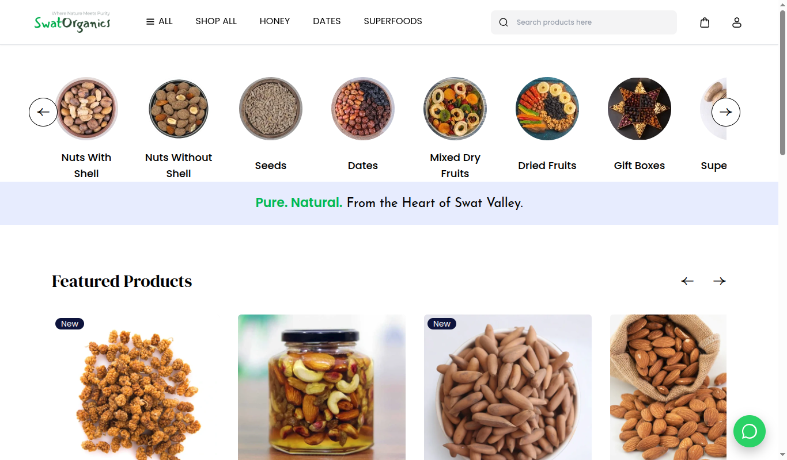
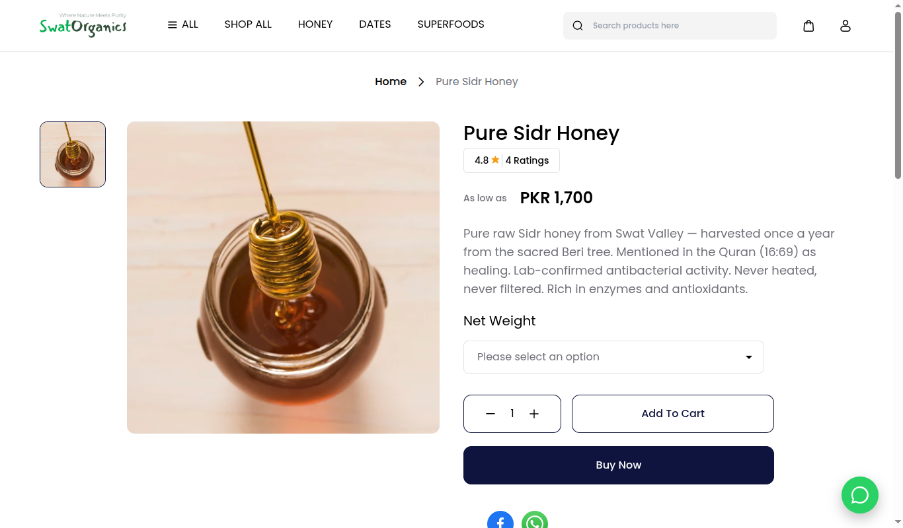
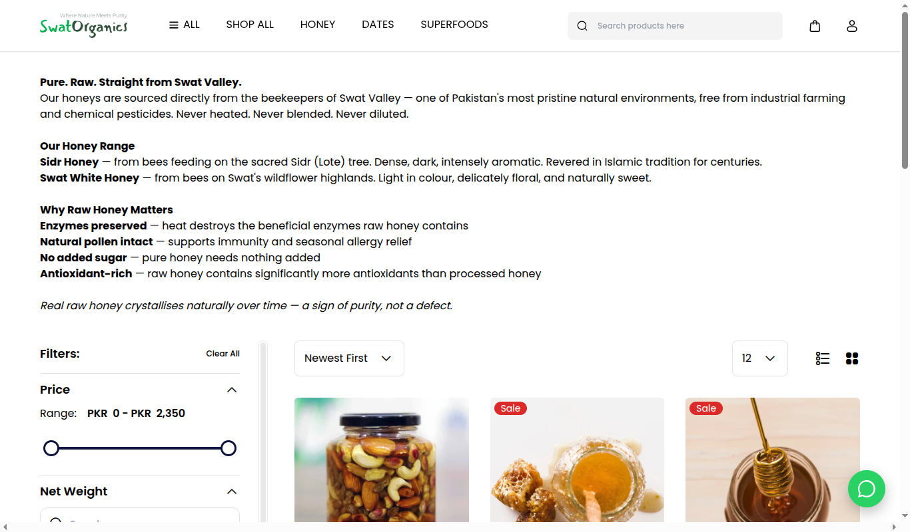
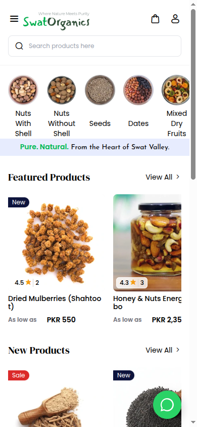

# SwatOrganics — Live E-commerce Store

**Live:** [swatorganics.com](https://swatorganics.com) · organic honey, dry fruits, superfoods and oils from Swat Valley, Pakistan.

A production online store built on [Bagisto](https://bagisto.com) (Laravel 11 + Vue), customised for the Pakistani
market: local delivery pricing, simplified checkout, Meta/Google ads tracking, SEO, and a scripted deploy to shared hosting.



| Product page | Category page | Mobile |
|---|---|---|
|  |  |  |

**Stack:** PHP 8.2 · Laravel 11 · Bagisto 2.x · Vue 3 · MySQL · Vite · LiteSpeed (shared hosting) · Meta Pixel / Conversions · GA4

## What I built on top of Bagisto

**Checkout & shipping (Pakistan market)**
- Threshold-based shipping rules in the `FlatRate` and `Free` carriers: flat Rs.200 delivery, free shipping
  over Rs.6,000. Each method shows only when its threshold applies, and the minimum order amount is configurable in admin.
- Checkout field configuration in admin system settings (e.g. optional street address for local addresses).
- Shipping/payment method auto-selected when only one is available. Simplified cart summary.
- Buy-now and empty-cart redirects fixed. Flash messages preserved across the login redirect when adding to cart.

**Marketing & analytics**
- Meta Pixel with `ViewContent`, `AddToCart` and `Purchase` events, wired into product, cart and order-success views.
- **Meta product catalogue feed** at `/meta-feed.csv` (`MetaFeedController`) for Facebook/Instagram shop ads,
  with correct stock-availability mapping.
- GA4 integration. Tracking IDs and Facebook domain verification moved to `config/tracking.php` and driven by `.env`.

**SEO**
- Structured data (Product / Organization) fixed for Google Search Console, Open Graph tags, sitemap and
  `robots.txt`, security headers.

**Catalogue & admin**
- Product data grid with a per-row delete action. Product observer fixes. Clearer error for missing configurable options.
- Branded storefront: header/footer, WhatsApp contact, category descriptions, font preloading.

**Production deployment** ([`deploy.sh`](deploy.sh))
- One-command deploy over SSH to shared hosting: pull branch, `composer install`, migrations only (never
  overwrites live data), cache rebuild, and LiteSpeed cache purge.
- LiteSpeed cache bypass for auth, checkout and API routes (`public/.htaccess`).
- Helper sub-commands for DB queries and remote `tinker`. Secrets live in a git-ignored `.deploy.env`.

## Running locally

```bash
composer install
cp .env.example .env && php artisan key:generate   # set DB_* and tracking IDs
php artisan bagisto:install                         # or: php artisan migrate --seed
npm install && npm run build
php artisan serve
```

A `docker-compose.yml` is included for a containerised setup (see Bagisto's
[Docker guide](https://devdocs.bagisto.com/2.3/introduction/docker.html)).

## Branches

- `dev`: what runs in production (deployed by `deploy.sh`)
- `main`: synced from `dev`

## Credits & licence

Built on [Bagisto](https://github.com/bagisto/bagisto) by Webkul, MIT licensed (see [LICENSE](LICENSE)).
Store customisations © Adil Khan.
